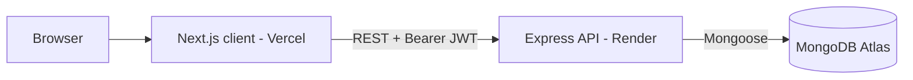
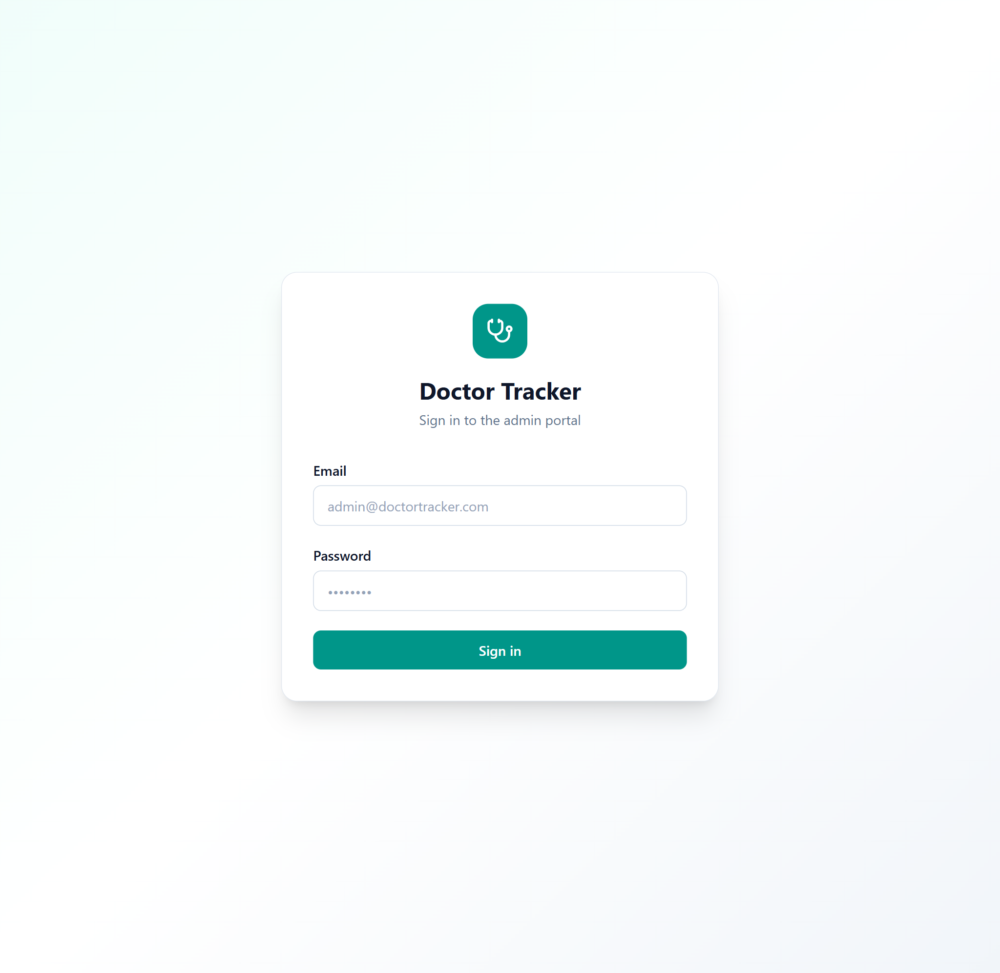
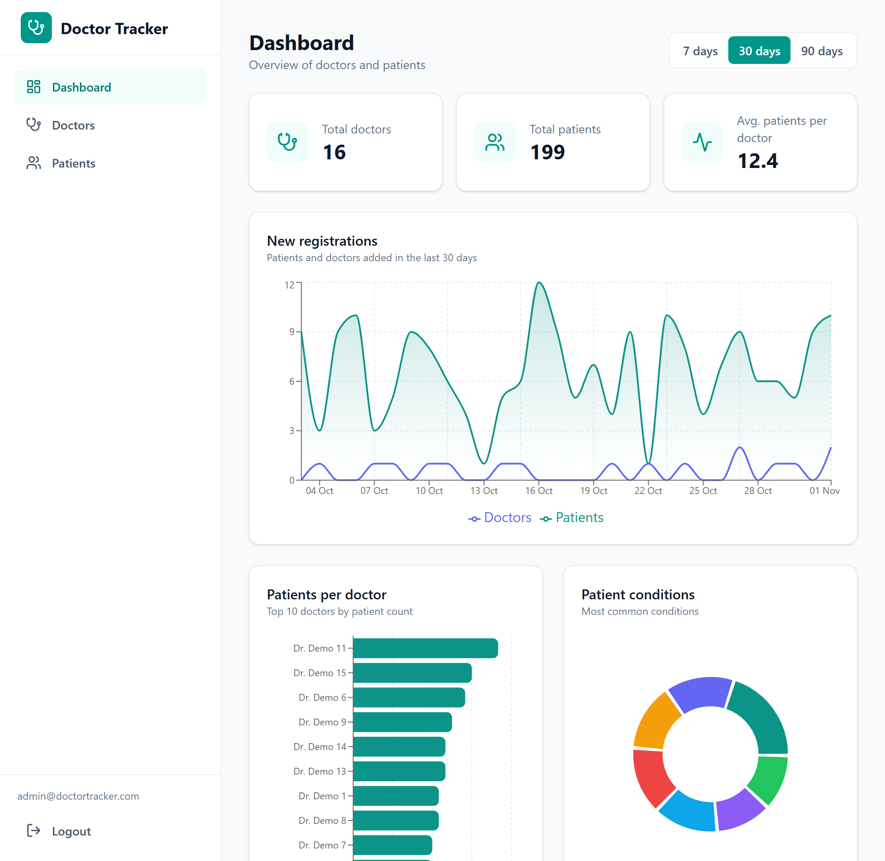
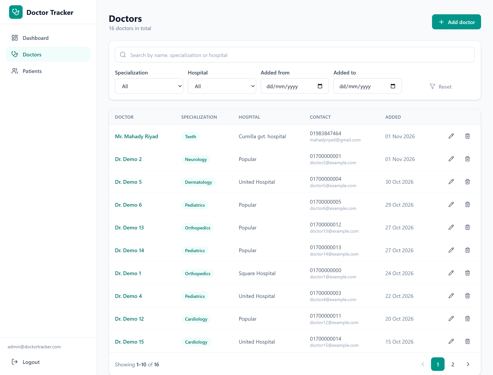
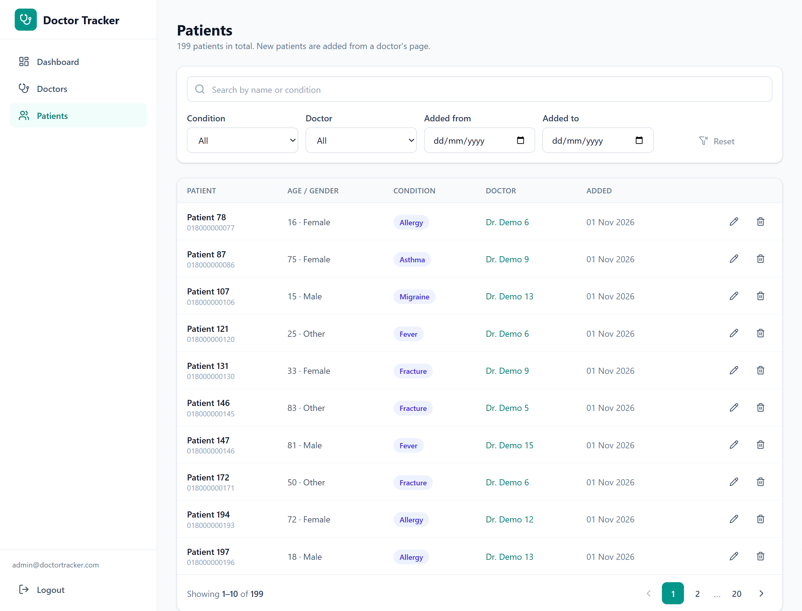
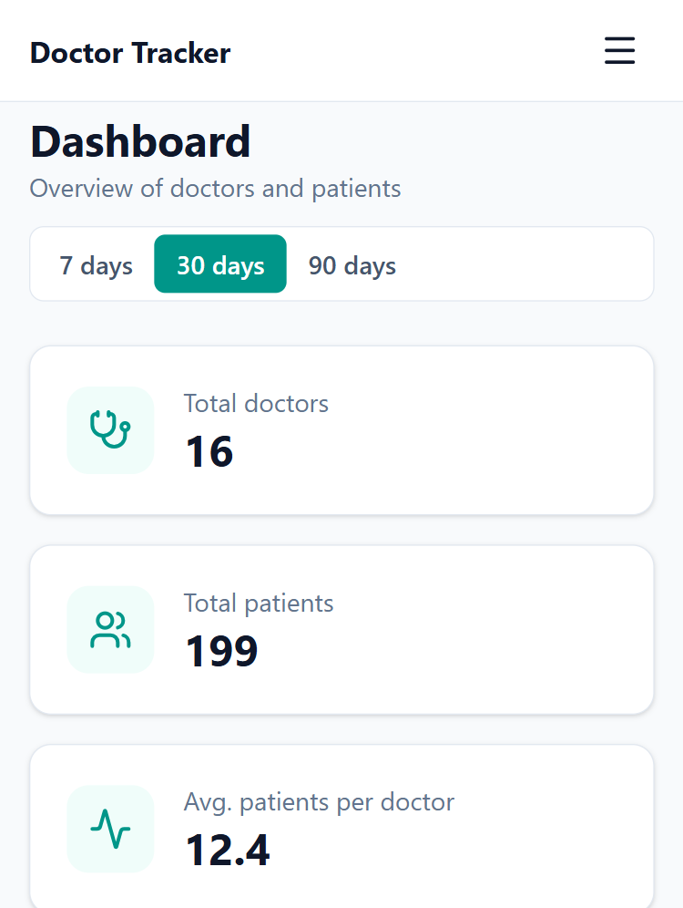
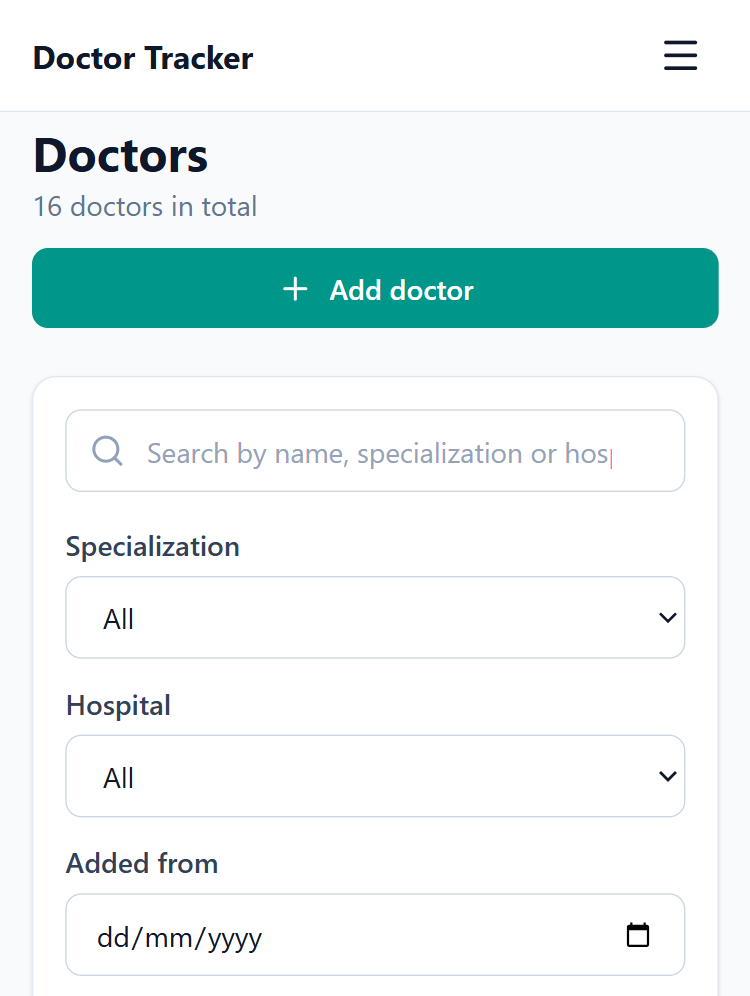
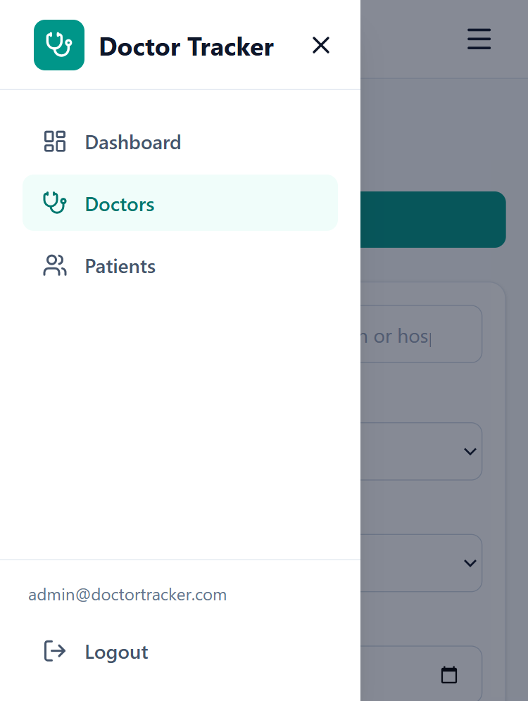

# Doctor Tracker Web

Doctor Tracker Web is the frontend of a secure admin portal for managing doctors and their patients. Authenticated admins can create and browse doctors, manage the patients assigned to each doctor, and explore the data through server-side search, filters and pagination, plus a dashboard with interactive charts (totals, patients per doctor, date-wise trends). It talks to a standalone REST API built with Express and MongoDB.

- **Live site:** https://doctor-tracker-web-cxf4-sable.vercel.app
- **Live API:** https://doctor-tracker-api-cnxs.onrender.com
- **Backend repo:** https://github.com/Shimul-DIU/doctor-tracker-api

> The API runs on Render's free tier, so the first request after inactivity can take 30-50 seconds while the server wakes up.

## Demo credentials

| Email | Password |
|---|---|
| admin@doctortracker.com | Dt@Demo2026!x |

**Stack:** Next.js (App Router) · TypeScript · Tailwind CSS · TanStack Query · Zustand · React Hook Form + Zod · Recharts · Axios

## Setup guide

**Prerequisites:** Node.js 20.19+ and the backend API running locally or deployed.

```bash
git clone https://github.com/Shimul-DIU/doctor-tracker-web.git
cd doctor-tracker-web
npm install
cp .env.example .env.local
npm run dev              # http://localhost:3000
```

`.env.example`:

```env
NEXT_PUBLIC_API_URL=http://localhost:5000/api
```

To run the backend locally, follow the setup guide in the [API repository](https://github.com/Shimul-DIU/doctor-tracker-api) (`npm run seed` creates the admin user and demo data). `npm run build` creates a production build.

## System architecture



1. The admin signs in and the API returns a signed JWT.
2. The token lives in a persisted Zustand store. An Axios interceptor attaches it to every request; a 401 response logs the user out and redirects to `/login`.
3. Pages read data through TanStack Query hooks, which cache responses and refetch only when the query key changes.
4. Search (debounced), filters and pagination go to the API as query parameters, so the database does the work and only one page of results reaches the browser.
5. The dashboard calls a single stats endpoint that aggregates everything on the database side.

```
src/
├─ app/          login route and a protected (app) group: dashboard, doctors, patients
├─ components/   AppShell, Providers, reusable ui/ pieces, feature components
├─ hooks/        data-fetching hooks (React Query) and utilities
├─ lib/          Axios instance and helpers
├─ store/        Zustand auth store
└─ types/        shared TypeScript types
```

## Technical decisions

### 1. TanStack Query for server state, Zustand only for auth
Almost all state here is server data (lists, pages, filters, statistics). Redux would need hand-written actions, reducers and loading/error handling for it. TanStack Query gives caching, request deduplication and cache invalidation after mutations (adding a patient refreshes the doctor's patient list and the dashboard) with far less code and fewer unnecessary re-renders. The only real client state is the auth session, which a small persisted Zustand store handles.

### 2. Bearer JWT instead of an httpOnly cookie
The frontend (Vercel) and the API (Render) are on different domains, and cross-site cookies are blocked by default in several browsers, including Safari. A token in the `Authorization` header works everywhere. Trade-off: a token in `localStorage` is exposed if an XSS bug exists, mitigated by React's output escaping, no `dangerouslySetInnerHTML`, a 1-day token lifetime and server-side validation. On a shared parent domain, httpOnly cookies would be the better choice.

## Screenshots

### Desktop

| Login | Dashboard |
|---|---|
|  |  |

| Doctors | Patients |
|---|---|
|  |  |

### Mobile

| Dashboard | Doctors | Menu |
|---|---|---|
|  |  |  |

## Deployment

- **Frontend:** Vercel, with `NEXT_PUBLIC_API_URL` set to the live API URL (ending in `/api`).
- **Backend:** Render, with `CLIENT_URL` set to the Vercel URL so CORS allows it.