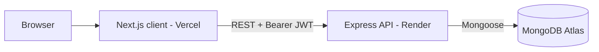

# Doctor Tracker Web

Doctor Tracker Web is the frontend of a secure admin portal for managing doctors and their patients. Authenticated admins can create and browse doctors, manage the patients assigned to each doctor, and explore the data through server-side search, filters and pagination, plus a dashboard with interactive charts (totals, patients per doctor, date-wise trends). It talks to a standalone REST API built with Express and MongoDB.

- **Live site:** https://<your-app>.vercel.app
- **Live API:** https://doctor-tracker-api-cnxs.onrender.com
- **Backend repo:** https://github.com/Shimul-DIU/doctor-tracker-api

> The API runs on Render's free tier, so the first request after inactivity can take 30-50 seconds while the server wakes up.

## Demo credentials

| Email | Password |
|---|---|
| admin@doctortracker.com | Admin@12345 |

## Tech stack

Next.js (App Router) · TypeScript · Tailwind CSS · TanStack Query · Zustand · React Hook Form + Zod · Recharts · Axios

## Setup guide

**Prerequisites:** Node.js 20.19 or newer, and the backend API running locally or deployed.

1. Clone the repository
   ```bash
   git clone https://github.com/Shimul-DIU/doctor-tracker-web.git
   cd doctor-tracker-web
   ```
2. Install dependencies
   ```bash
   npm install
   ```
3. Create your environment file from the example
   ```bash
   cp .env.example .env.local
   ```
4. Set the API URL in `.env.local`
   ```env
   NEXT_PUBLIC_API_URL=http://localhost:5000/api
   ```
5. Start the dev server
   ```bash
   npm run dev
   ```
6. Open http://localhost:3000 and sign in with the demo credentials.

To run the backend locally, follow the setup guide in the [API repository](https://github.com/Shimul-DIU/doctor-tracker-api) (`npm run seed` creates the admin user and demo data).

### Scripts

| Command | Description |
|---|---|
| `npm run dev` | Start the development server |
| `npm run build` | Create a production build |
| `npm start` | Run the production build |
| `npm run lint` | Lint the code |

## System architecture



**Data flow**

1. The admin signs in. The API verifies the credentials and returns a signed JWT.
2. The token is stored in a persisted Zustand store. An Axios interceptor attaches it to every request, and a 401 response logs the user out and redirects to `/login`.
3. Pages read data through TanStack Query hooks, which cache responses and refetch only when the query key changes.
4. Search, filters and pagination are sent as query parameters. MongoDB does the work using text and compound indexes, and only one page of results returns to the browser.
5. The dashboard calls a single stats endpoint that aggregates everything on the database side.

**Frontend structure**

```
src/
├─ app/          routes (login, and a protected (app) group for dashboard, doctors, patients)
├─ components/   AppShell, Providers, reusable ui/ pieces, feature components
├─ hooks/        data-fetching hooks (React Query) and utilities
├─ lib/          Axios instance and helpers
├─ store/        Zustand auth store
└─ types/        shared TypeScript types
```

## Technical decisions

### 1. TanStack Query for server state, Zustand only for auth

Most state in this app is server data: lists, pages, filters and statistics. Putting it in Redux would mean writing actions, reducers and loading/error handling by hand. TanStack Query provides caching, request deduplication, background refetching and cache invalidation after mutations (for example, adding a patient refreshes the doctor's patient list and the dashboard). That also avoids unnecessary re-renders. The only real client state is the auth session, which is small enough for a minimal Zustand store with persistence, so Redux would add boilerplate without a benefit.

### 2. Bearer JWT instead of an httpOnly cookie

The frontend (Vercel) and the API (Render) live on different domains. Cross-site cookies need `SameSite=None; Secure` and are blocked by default in several browsers, including Safari, which makes sessions unreliable. A JWT sent in the `Authorization` header works the same everywhere. The trade-off is that a token in `localStorage` is exposed if an XSS bug exists. This is mitigated by React's output escaping, no `dangerouslySetInnerHTML`, a short token lifetime (1 day) and server-side validation. With a shared parent domain, httpOnly cookies would be the better choice.

## Screenshots

### Desktop

| Login | Dashboard |
|---|---|
|  |  |

| Doctors | Patients |
|---|---|
|  |  |

### Mobile

| Dashboard | Doctors | Menu |
|---|---|---|
|  |  |  |

## Deployment

- **Frontend:** Vercel. Set `NEXT_PUBLIC_API_URL` to the live API URL (ending in `/api`).
- **Backend:** Render. Set `CLIENT_URL` to the Vercel URL so CORS allows it.